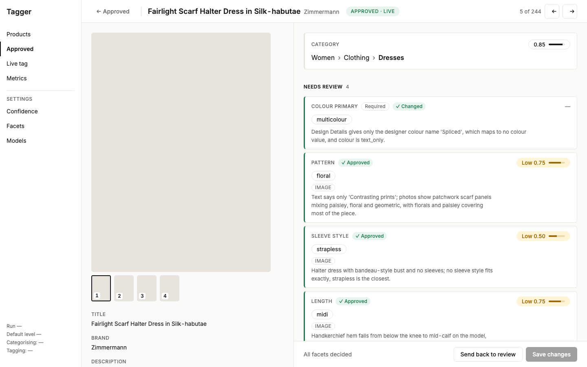
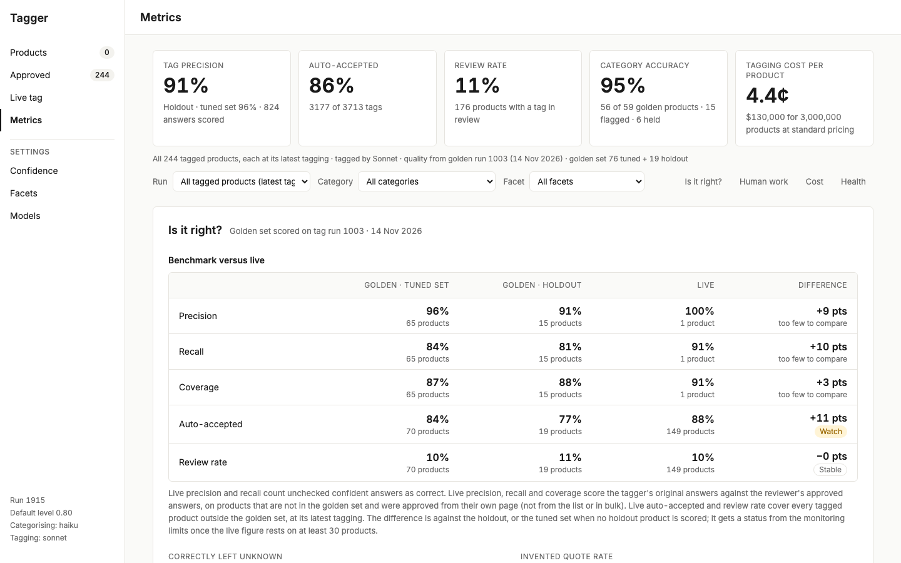
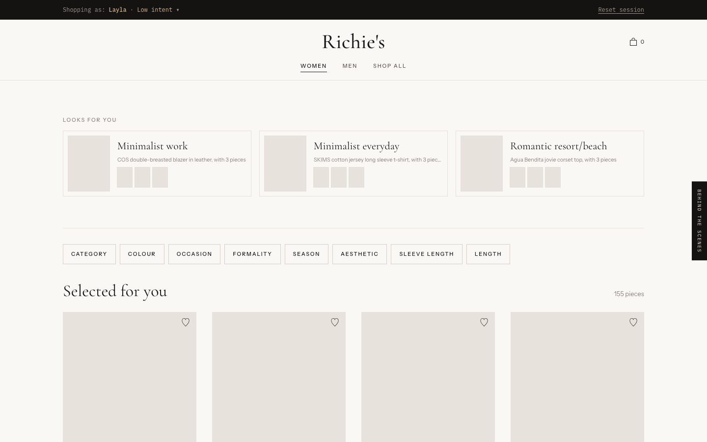
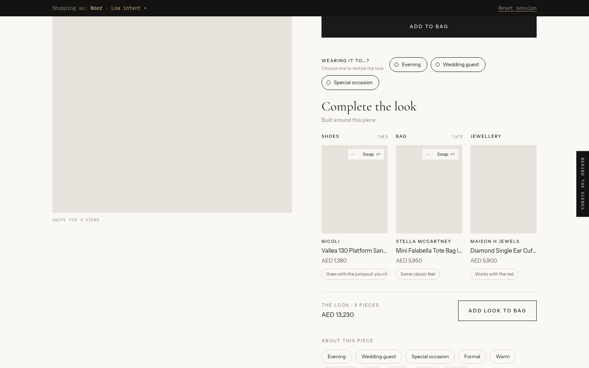

# Ounass AI product tagger

An AI tagger for a luxury fashion catalogue, a review app where a merchandiser checks and approves its work, and a sample store that uses the approved tags to style outfits for an occasion.

The tagger reads a product page and photos. It places the product in the right category and fills in its facets, such as colour, occasion, fit, neckline and heel height. Each answer comes with a confidence score and a quote from the product page as evidence. Confident answers are accepted automatically; the rest wait for a person. Only approved products reach the store.

| Tagger app: review one product | Tagger app: metrics |
| --- | --- |
|  |  |

| Store: looks for a returning shopper | Store: complete the look for an occasion |
| --- | --- |
|  |  |

Product photos are blanked out in these screenshots. They belong to Ounass and its brands, and they are not in this repository.

## Results at a glance

The tagger was scored against a hand-labelled golden set of 95 products: 76 used while tuning the instructions, and 19 held out and never looked at. The figures below are for tag run 1003 (Claude Sonnet 5.5) and categorise run 1002 (Claude Haiku 5.5), as printed by `tagger evaluate --run 1003` on 15 Nov 2026.

| Measure | Tuned set | Holdout |
| --- | --- | --- |
| Category accuracy (exact category) | 88.2% of 76 | 78.9% of 19 |
| Tag precision (answers given that are right) | 95.8% | 91.3% |
| Tag recall (correct answers found) | 84.3% | 80.6% |
| Tag answers accepted without a person ¹ | 84.4% | 76.7% |
| Review rate (answers sent to a person) | 9.3% | 9.4% |
| Cost per product, both steps | $0.044 | |

¹ From the app's Metrics tab for the same run; `tagger evaluate` does not print this figure. The Metrics tab counts its review rate per answer, so it shows 10% and 11% for the same run.

Tag figures cover the golden products whose category was right: 65 tuned and 15 holdout products. The holdout is small, so treat its figures as a check, not a precise measure. The scorecards are in [reports/](reports/), and [How quality is measured](docs/quality.md) explains each figure.

## How it works

```
 Ounass page ──► scrape ──► categorise ──► gate ──► tag ──► derive ──► review ──► store
 (public)        text,      Haiku 5.5      category  Sonnet 5.5  rules    a person   approved
                 4 photos   picks the      confident    fills in  in code   approves   products only
                            category       enough?      facets
```

1. **Scrape.** The scraper reads one product page, keeps its text and up to 4 photos, and saves them to the database and to private storage. It sends one request at a time, 1.5 to 2.5 seconds apart, and obeys robots.txt.
2. **Categorise.** Claude Haiku 5.5 places the product on the category spine (1,169 categories, five levels deep) and gives a confidence score.
3. **Gate.** A category below its confidence level (0.75) waits for a person before the product is tagged. The exception is when the two likeliest categories share the same facets: then the product is tagged and only the category is sent for review.
4. **Tag.** Claude Sonnet 5.5 reads the text and photos and fills in every facet that applies to that category. Each answer has a confidence score, an evidence quote and the source (text or image).
5. **Derive.** Code, not a model, fills in facets that follow from rules, such as price band and how new a product is.
6. **Review and approve.** Answers above their facet's confidence level are accepted. The rest wait in the tagger app until a person approves or corrects them. Approving publishes the product.
7. **Store.** Richie's, the sample store, reads only approved products. Its occasion assistant uses their occasion, formality, colour and style tags to build outfits.

The rules the tagger follows live in [config/](config/), in the database seeded from it, and in two skill files in [skills/](skills/). No facet is hard-coded.

## What you need

Tested on macOS 15.7 (Apple silicon). Linux and Windows are untested.

| Tool | Version | Check with |
| --- | --- | --- |
| git | any recent | `git --version` |
| Python | 3.11 or later (tested with 3.13.4); uv installs it if missing | `python3 --version` |
| [uv](https://docs.astral.sh/uv/getting-started/installation/) | 0.7 or later (tested with 0.7.12) | `uv --version` |
| Node.js and npm | Node 18 or later (tested with Node 25.5.0, npm 11.8.0) | `node --version` |

You also need two accounts of your own:

- **Supabase** (free plan is enough): the database and photo storage. Create a project at [supabase.com](https://supabase.com).
- **Anthropic API**: for the tagging models. Create a key at [console.anthropic.com](https://console.anthropic.com). Tagging costs about 4 to 5 cents a product.

## Setup

These steps take you from an empty Supabase project to both apps running. Nothing here calls a model or costs money.

> The empty-database path below follows the code but has not been run end to end from a brand-new Supabase project. See [Limits](#limits-and-what-is-not-built).

1. Get the code and install everything (Python packages, then both web front ends):

   ```bash
   git clone https://github.com/richiekop05/ounass-case-study.git ounass-tagger
   cd ounass-tagger
   uv sync --extra dev --locked
   npm ci --prefix web && npm run build --prefix web
   npm ci --prefix store/web && npm run build --prefix store/web
   ```

   Run every later command from this folder.

2. Create a Supabase project, then copy the settings file and fill it in:

   ```bash
   cp .env.example .env
   ```

   Open `.env` in an editor. Each line says where to find its value. [Environment variables](#environment-variables) has the full list.

3. Create the tables and the photo bucket, then load the categories, facets and store rules:

   ```bash
   uv run catalog migrate
   uv run scraper plan --spine ounass_spine_v5_nodes.csv
   uv run catalog seed-taxonomy
   uv run richies seed-rules
   ```

   - `catalog migrate` applies the 25 migrations in `db/migrations/` in order. It also creates the private storage bucket `product-images`. It is safe to run again.
   - `scraper plan` loads the 1,169 categories. It leaves the reviewed `config/sample_plan.csv` as it is.
   - `seed-taxonomy` loads the facets, their values and rubrics, which facets apply to which category, and the brands.
   - `seed-rules` loads the store's occasions, outfit roles, look templates, colour pairings and the four shopper personas.

4. Start the apps:

   ```bash
   uv run richies serve --with-tagger
   ```

   - Store: http://127.0.0.1:8780/
   - Tagger app: http://127.0.0.1:8765/

   To run the tagger app on its own, use `uv run tagger app`. Both apps listen on your computer only. Stop them with Ctrl+C.

The store is empty until you approve some products. The tables are described in [docs/database.md](docs/database.md).

## Tag your first products

Each product you tag costs about **4 to 5 cents** in API usage. For a first batch, 10 products is a good size, about 50 cents.

**In the tagger app (quickest)**

1. Open http://127.0.0.1:8765/ and go to **Live tag**.
2. Choose **Single product** and paste a product link from ounass.ae. Or choose **Listing page**, paste a category or brand page link, and set **First** to 10. Press **Tag product** or **Tag 10 products**. 💲 *Costs money.*
3. The page shows each product being fetched, categorised and tagged. When it is done, review it on the same page.
4. Go to **Products**. Open a product, check each answer, change any that are wrong, and press **Approve and publish**. **Ready** products can be approved straight from the list.
5. Open the store at http://127.0.0.1:8780/. The approved product is now on its department's listing page.

A third mode, **Store sample (listing)**, adds products to the store without review, for filling it out quickly. Store samples never appear in the tagger app's tabs or figures.

**From the command line**

```bash
uv run scraper scrape --limit 10        # scrape 10 products from the sample plan; no model calls
uv run tagger run --limit 10            # categorise, tag and derive them (costs money)
```

Then approve them in the tagger app as in steps 4 and 5 above. `scraper scrape` reads the listing pages named in `config/sample_plan.csv`. To choose your own products, use Live tag.

**Store personas.** The four demo shoppers (Layla, Noor, James and Sara) start with a browsing history made of 23 particular products. That history loads only when all 23 are in your store. Until then the personas behave like new shoppers. The store still works, but Looks for you and the personalised ranking will not show. To load the histories, tag and approve those products, then run `uv run richies load-personas`. The product IDs are in `store/sample_data/personas.json`.

**Reproducing the evaluation.** This cannot be done from an empty database with the commands as they are. `tagger golden import` loads answers only for products already in the golden set, and nothing creates that set from `golden/golden_master.xlsx`. The answer key is in the repository, and the scored results are in the scorecards in [reports/](reports/). Tagging the 95 golden products would cost about $4.

## Environment variables

All five go in `.env`, which is never committed. [.env.example](.env.example) lists them with placeholders.

| Name | What it is for | Required | Where to get it |
| --- | --- | --- | --- |
| `SUPABASE_DB_URL` | Database connection for every command and both apps | Yes | Supabase: **Connect** button → **Session pooler** connection string, with your database password filled in |
| `SUPABASE_URL` | Photo storage: uploading on scrape, signed links in the apps | Yes, for scraping and photos | Supabase: **Project Settings** → **Data API** → project URL |
| `SUPABASE_SERVICE_KEY` | Photo storage access | Yes, for scraping and photos | Supabase: **Project Settings** → **API Keys** → the secret (service role) key. Keep it private. |
| `SCRAPER_USER_AGENT` | Identifies the scraper to ounass.ae; put a contact address in it | Yes, for scraping | Write your own, as in `.env.example` |
| `ANTHROPIC_API_KEY` | The tagging models | Yes, for tagging | [console.anthropic.com](https://console.anthropic.com) → API keys. `uv run tagger models set-key ANTHROPIC_API_KEY` stores it without showing it on screen. |

## Things to try

A five-minute tour once a few products are tagged:

1. **Approve a product.** In the tagger app, open **Products**, then a product. Each facet shows its answer, confidence, evidence quote and source. Change an answer and press **Approve and publish**.
2. **Move a confidence level.** On **Confidence**, change a facet's level. Before you press **Apply**, it shows how many answers would move into or out of review.
3. **Tag a product live.** On **Live tag**, paste any Ounass product link. It is fetched, categorised and tagged in about a minute.
4. **Ask the store for an occasion.** Open the store and pick an occasion under **Where are you going?** on a listing page. Or open a product and answer **Wearing it to…?** to restyle its outfit, then use **Swap** to try other pieces. **Behind the scenes** on the right edge shows why the store chose what it shows.
5. **Read the metrics.** **Metrics** compares the golden set with live tagging, and shows each facet's scorecard, the review work done and the cost.

## Commands

The main ones; [docs/commands.md](docs/commands.md) has the rest. Every command starts with `uv run`. 💲 marks commands that call a model and cost money.

| Command | What it does |
| --- | --- |
| `tagger categorise --limit N` 💲 | Step 1 for products not yet categorised |
| `tagger tag --limit N` 💲 | Steps 2 and 3 for products whose category was accepted |
| `tagger run --limit N` 💲 | All three steps |
| `tagger evaluate --run ID` | Score a tag run against the golden set; writes `reports/facet_scorecard_run<ID>.xlsx` |
| `tagger restatus --run ID` | Recalculate each answer's status from the current confidence levels; no model call |
| `tagger golden import FILE` | Load golden answers from a sheet, including `golden/golden_master.xlsx` |
| `tagger review export --run ID` / `review import FILE` | Review a run in a spreadsheet instead of the app |
| `tagger publish --run ID` | Point products at a run; publishing happens only by approval |
| `tagger app` | Start the tagger app |
| `richies serve --with-tagger` | Start the store and the tagger app |

## Repository map

| Folder | What it holds |
| --- | --- |
| `src/scraper/` | The scraper: reads Ounass pages politely and saves products and photos |
| `src/catalog/` | Migrations runner and the taxonomy seed |
| `src/tagger/` | The tagging pipeline: categorise, tag, derive, evaluate, monitor, golden set, model profiles |
| `src/app/`, `web/` | The tagger app: Python API and React front end |
| `store/richies/`, `store/web/` | Richie's store: Python API and React front end |
| `store/sample_data/` | The store's rules and the four personas' starting histories |
| `db/migrations/` | The database schema, applied in file order |
| `config/` | Facet policy and definitions, the facet dictionary workbook, brands, model profiles and prices, pipeline settings, the sample plan |
| `skills/` | The categorising and tagging instructions sent to the models |
| `ounass_spine_v5_nodes.csv` | The category spine: 1,169 categories, L1 to L5 |
| `golden/` | The golden answer key (`golden_master.xlsx`) and the holdout sheet |
| `reports/` | Facet scorecards from evaluated runs |
| `tests/`, `store/tests/` | Tests |
| `scripts/` | One-off helpers, including the generator for `docs/database.md` |
| `docs/` | This documentation, the [developer reference](docs/reference.md), the [table reference](docs/database.md), and the specifications the apps were built from (`docs/app/`, `docs/store/`) |

## How quality is measured

In short: every figure compares the tagger's answers with the golden set, a person's answers for 95 products. The 19 holdout products were kept aside and never used while tuning, so they show how the tagger does on products it was not tuned on. Precision asks "when it answers, is it right?" Recall asks "of the right answers, how many did it find?" The auto-accepted share and review rate show how much work is left for a person. The full explanation is in [docs/quality.md](docs/quality.md).

## Troubleshooting

See [docs/troubleshooting.md](docs/troubleshooting.md).

## Limits and what is not built

- **A prototype.** It was built and measured on a few hundred products, not a full catalogue. The holdout is 19 products, which is too small for precise figures.
- **Synthetic shoppers.** The store's four personas and their histories were written for the demo. No real shopper data is used.
- **No checkout, no sign-in, no accounts.** The store's bag is for show. Both apps run on your own computer only, for one person at a time.
- **Not tested from a brand-new database.** The setup steps follow the code and were checked on the working project, but not run from an empty Supabase project. If a step fails, [docs/troubleshooting.md](docs/troubleshooting.md) lists the likely causes.
- **Evaluation not reproducible from empty.** See [Tag your first products](#tag-your-first-products).
- **Fresh databases use the default confidence level.** Three facets (occasion, formality and aesthetic) were set to review at 0.70 instead of the default 0.80 in the tuned project. A fresh database starts them at 0.80; set them on the **Confidence** tab to match.

## Data and credits

Product data was collected from the public Ounass website (ounass.ae) for this case study only. It is not for redistribution, and no product photo is included here. The scraper obeys robots.txt, sends one request at a time and stops at any sign of blocking.

Built by Richard George with Claude Code. Models: Claude Haiku 5.5 categorises, Claude Sonnet 5.5 tags, and Claude Opus 5.5 drafted golden labels for a person to review.
